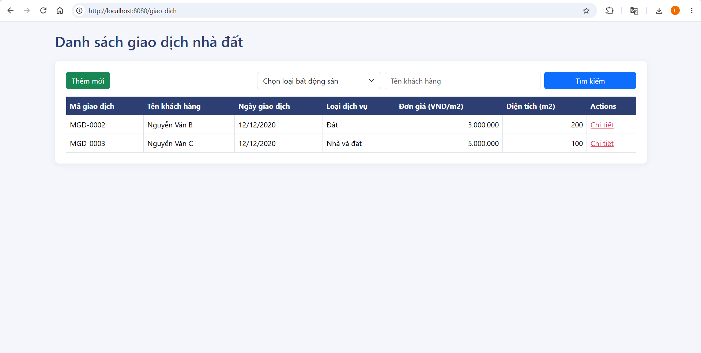
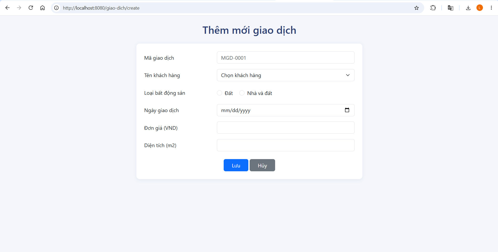
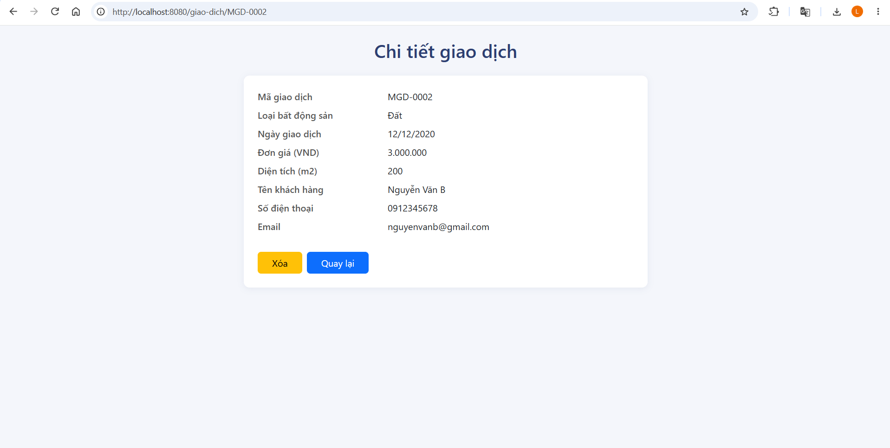

# CodeGym Property Transaction

Ứng dụng quản lý giao dịch nhà đất tại công ty bất động sản, với các chức năng xem danh sách, thêm mới, xem chi tiết, xóa và tìm kiếm giao dịch.

## Cài đặt

### 1. Tạo database
Mở MySQL Workbench (hoặc MySQL Command Line Client) và chạy file `database.sql`. File này tạo database `bds_db`, hai bảng `khach_hang`, `giao_dich` và dữ liệu mẫu.

> Chỉ chạy file một lần để tránh chèn trùng dữ liệu mẫu.

### 2. Cấu hình kết nối database
Mở file `main` và chỉnh sửa nếu cần:

```properties
spring.datasource.url=jdbc:mysql://localhost:3306/bds_db?createDatabaseIfNotExist=true&useSSL=false&allowPublicKeyRetrieval=true&serverTimezone=Asia/Ho_Chi_Minh&characterEncoding=UTF-8
spring.datasource.username=root
spring.datasource.password=123456
```

### 3. Cài đặt và chạy với IntelliJ IDEA

1. Mở thư mục project (chứa `pom.xml`) trong IntelliJ IDEA
2. Đợi Maven tải xong các thư viện (hoặc bấm **Reload All Maven Projects** trong tab Maven)
3. Kiểm tra Project SDK là JDK 17 trở lên (**File → Project Structure → Project**)
4. Mở `BdsApplication.java` và bấm **Run** (không cần cài Tomcat riêng, Spring Boot đã nhúng sẵn)

### 4. Truy cập ứng dụng

Mở trình duyệt và truy cập:
- Danh sách giao dịch: `http://localhost:8080/giao-dich`
- Thêm mới giao dịch: `http://localhost:8080/giao-dich/create`

## Chức năng

- **Danh sách giao dịch**: Hiển thị mã giao dịch, tên khách hàng, ngày giao dịch, loại dịch vụ, đơn giá, diện tích
- **Thêm mới giao dịch**: Chọn khách hàng từ danh sách, chọn loại dịch vụ (Đất, Nhà), kiểm tra dữ liệu nhập:
  - Các trường bắt buộc nhập
  - Mã giao dịch đúng định dạng `MGD-XXXX` (X là chữ số 0-9)
  - Ngày giao dịch phải lớn hơn ngày hiện tại
  - Đơn giá là số và lớn hơn 500.000 (VND)
  - Diện tích là số và lớn hơn 20 (m²)
- **Chi tiết giao dịch**: Xem thông tin giao dịch và thông tin khách hàng (tên, số điện thoại, email)
- **Xóa giao dịch**: Có hộp thoại xác nhận trước khi xóa
- **Tìm kiếm giao dịch**: Theo tên khách hàng (tìm tương đối), theo loại dịch vụ, hoặc kết hợp cả hai

## Giao diện ứng dụng







## Cấu trúc thư mục

```
src/main/java/com/codegym/bds
├── controller   # Xử lý request (GiaoDichController, HomeController)
├── dto          # GiaoDichDto: dữ liệu form và validate
├── entity       # KhachHang, GiaoDich
├── repository   # Truy vấn database (Spring Data JPA)
└── service      # Xử lý nghiệp vụ
src/main/resources
├── templates    # list.html, create.html, detail.html
└── static/css   # style.css
```

## Công nghệ

- Java 17+
- Spring Boot 3.3.5 (Spring MVC, Spring Data JPA, Validation)
- MySQL 8.0+
- Thymeleaf + Bootstrap 5
- Maven
